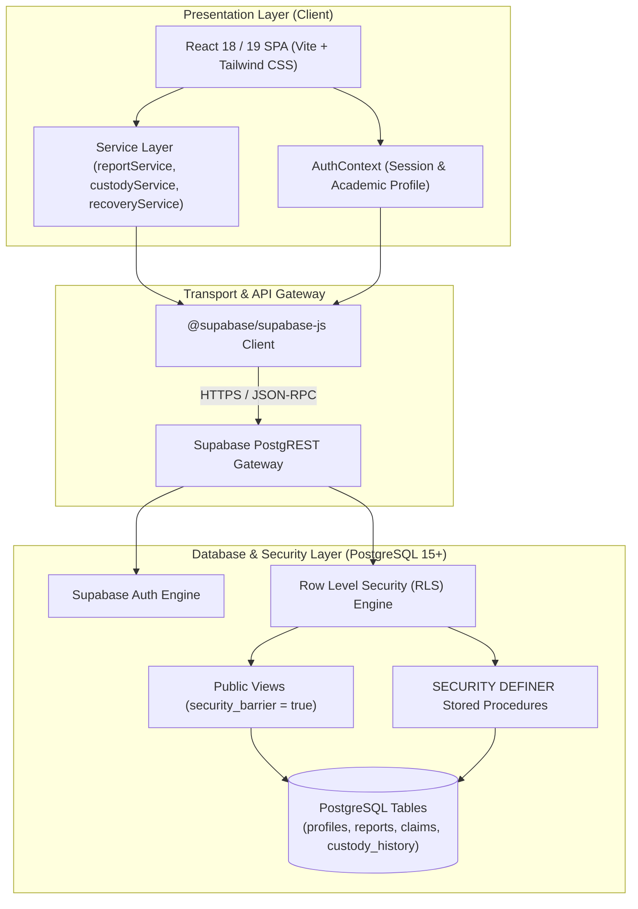
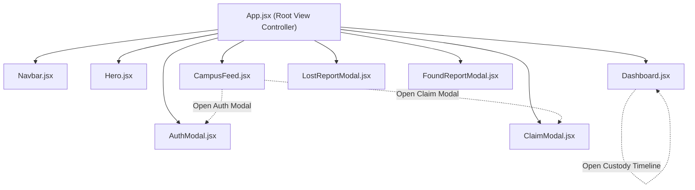
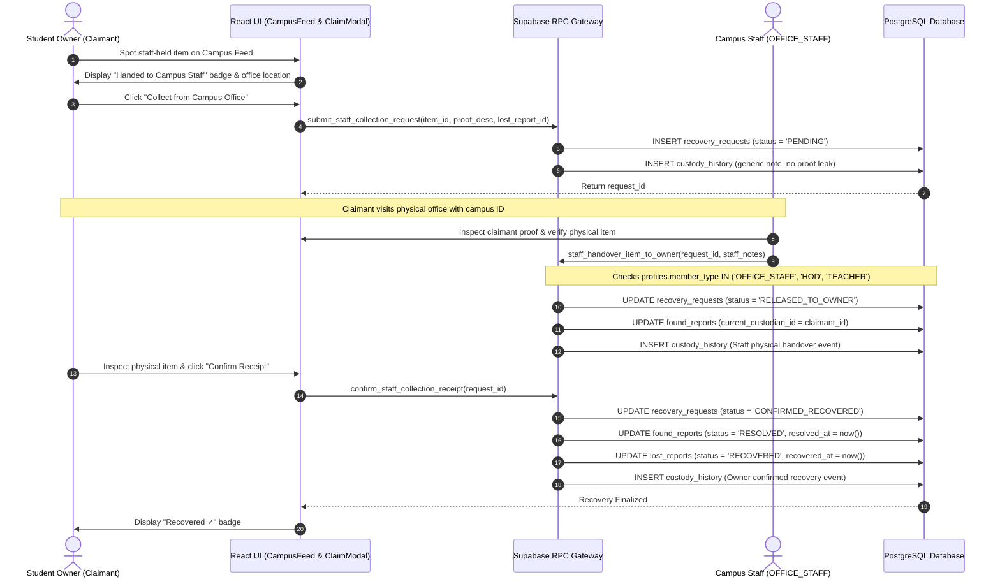

# System Architecture & Technical Design

## Project: FindIt – Campus Item Recovery & Coordination System

---

## 1. High-Level Architecture Diagram



---

## 2. Component Hierarchy & Flow



---

## 3. Sequence Flows

### 3.1. Staff-Held Item Recovery Sequence (Bug 4 Flow)



---

## 4. Custody Lifecycle State Machine

```mermaid
stateDiagram-v2
    [*] --> REPORTED_BY_FINDER: Found Report Created

    state REPORTED_BY_FINDER {
        [*] --> FINDER_CUSTODY: Held by Finder
        [*] --> STAFF_CUSTODY: Deposited with Staff
    }

    state FINDER_CUSTODY {
        TRANSFER_PENDING --> TRANSFERRED_TO_PEER: Recipient Accepts
        TRANSFER_PENDING --> FINDER_CUSTODY: Recipient Rejects
        FINDER_CUSTODY --> TRANSFER_PENDING: Custodian Initiates Transfer
        FINDER_CUSTODY --> STAFF_CUSTODY: Deposited with Staff Checkpoint
        FINDER_CUSTODY --> PEER_CLAIM_PENDING: Owner Submits Claim
        PEER_CLAIM_PENDING --> PEER_CLAIM_ACCEPTED: Custodian Accepts Proof
        PEER_CLAIM_PENDING --> FINDER_CUSTODY: Custodian Rejects Proof
        PEER_CLAIM_ACCEPTED --> RESOLVED: Custodian Confirms Recovery
    }

    state STAFF_CUSTODY {
        STAFF_COLLECTION_PENDING --> RELEASED_TO_OWNER: Staff Handover (Authorized Role)
        STAFF_CUSTODY --> STAFF_COLLECTION_PENDING: Owner Requests Collection
        RELEASED_TO_OWNER --> RESOLVED: Owner Confirms Physical Receipt
    }

    RESOLVED --> [*]: Recovery Complete (Leaves Active Feed)
```

---

## 5. Security & Isolation Boundaries

1. **Client Isolation:**
   - The browser client is strictly untrusted. No database direct table permissions (`INSERT`/`UPDATE`) are granted to `authenticated` or `anon`.
   - All mutations are handled by server-side PostgreSQL functions running with elevated `SECURITY DEFINER` privileges.
2. **Search Path Isolation:**
   - Every `SECURITY DEFINER` RPC enforces `SET search_path = ''`.
   - Standard system types and functions use explicit `pg_catalog.` qualification, neutralizing schema override attacks.
3. **Role Gating:**
   - `staff_handover_item_to_owner` queries `public.profiles.member_type` for the calling user's ID (`auth.uid()`).
   - Only `OFFICE_STAFF`, `HOD`, and `TEACHER` roles can record physical releases. Calls from `STUDENT` or unauthenticated sessions are aborted before any row lock or state mutation.
4. **Audit Immutability:**
   - `public.custody_history` lacks `UPDATE` and `DELETE` policies, guaranteeing that every transfer event remains permanently recorded.
